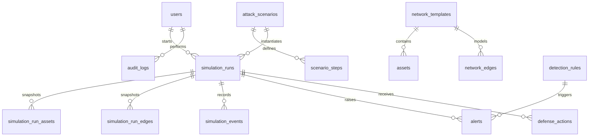

# CyberOps Arena

CyberOps Arena is an educational backend for deterministic, isolated attack and defense exercises. It changes virtual records only: it does not scan hosts, execute uploaded code, change real accounts, or configure real firewalls.

## Current implementation

This repository provides a Spring Boot 3.5 application, MySQL 8.4 schema managed by Flyway, account login with signed short lived bearer tokens, per-run snapshots, deterministic scenario stepping, graph reachability checks, a small rule based alert engine, simulated defenses, audit rows, an overview/run metrics API, and a Docker Compose setup.

This is a working foundation, not the entire requested product scope. Scenario authoring APIs, comprehensive pagination, detailed latency metrics, complete API/security/transaction/concurrency test coverage, and several lifecycle edge cases remain to be implemented. A MySQL Testcontainers lifecycle acceptance test and graph unit tests are included. Do not treat it as production-ready intrusion detection.

## Architecture

The application is a modular monolith. REST controllers validate incoming DTOs and call services. `SimulationService` coordinates short MySQL transactions using parameterized JDBC statements; Spring Data JPA is also configured with a `User` mapping and repository. Flyway is the schema authority and Hibernate runs in `validate` mode. The graph helper uses directed breadth-first search over the run's enabled, unblocked edges. A row lock on each run serializes start, step, stop, and defense work for that run. Each run receives its own asset and edge rows, so defenses do not alter template state or another run.

Request path: HTTP request → Spring Security token filter → controller validation → service authorization/business checks → transaction and MySQL → response DTO/map. The initial version uses synchronous detection in the same transaction as each event. No external side effects are performed.

## Stack and prerequisites

- Java 21 and Maven 3.6.3 or newer for local development
- MySQL 8.4 (or Docker Engine with Compose)
- Spring Boot 3.5.16, Spring Web/Security/Data JPA/Validation, Flyway, MySQL Connector/J, Springdoc OpenAPI

Spring Boot 3.5.16 supports Java 17 through 25, so Java 21 is within its supported range. Flyway MySQL support is included as the separate `flyway-mysql` dependency.

## Start with Docker

1. Copy `.env.example` to `.env` and replace all placeholder values. Use a unique database password, root password, and at least 32 random characters for `JWT_SECRET`. Bootstrap administrator credentials are optional; when set, all three values are required and the password must be at least 14 characters.
2. Start the service with `docker compose up --build -d`.
3. Check readiness at `http://localhost:8080/actuator/health/readiness` and openAPI at `http://localhost:8080/swagger-ui/index.html`.
4. The persistent named volume is `mysql_data`. Normal startup does not remove it. To intentionally erase local database data, use `docker compose down -v`.

The Compose MySQL image initializes the named database and a separate application user on first startup. The backend waits for MySQL's health check before starting. Flyway applies migrations automatically from an empty database.

## Local startup with an existing MySQL server

Create a database and a least privilege application user using an administrative MySQL account:

```sql
CREATE DATABASE cyberops_arena CHARACTER SET utf8mb4 COLLATE utf8mb4_0900_ai_ci;
CREATE USER 'cyberops'@'%' IDENTIFIED BY 'replace-with-a-long-random-password';
GRANT SELECT, INSERT, UPDATE, DELETE, CREATE, ALTER, INDEX, REFERENCES ON cyberops_arena.* TO 'cyberops'@'%';
```

Flyway needs schema migration permissions for bootstrap. For a stricter deployed environment, run migrations with a separate migration identity, then remove DDL grants from the runtime identity. Set the variables below in the shell (never commit real secrets), then run `mvn spring-boot:run`.

| Variable | Default | Purpose |
| --- | --- | --- |
| `DB_HOST` | `localhost` | MySQL hostname |
| `DB_PORT` | `3306` | MySQL port |
| `DB_NAME` | `cyberops_arena` | Database name |
| `DB_USERNAME` | `cyberops` | Application database user |
| `DB_PASSWORD` | `cyberops-local` | Application database password |
| `JWT_SECRET` | none | HMAC key; required and at least 32 characters |
| `JWT_EXPIRATION` | `1800` | Access-token lifetime in seconds |
| `SERVER_PORT` | `8080` | HTTP port |
| `CORS_ORIGINS` | `http://localhost:3000` | Comma-separated frontend origins |
| `BOOTSTRAP_ADMIN_USERNAME` | none | Optional one-time dev admin creation |
| `BOOTSTRAP_ADMIN_EMAIL` | none | Optional bootstrap email |
| `BOOTSTRAP_ADMIN_PASSWORD` | none | Optional bootstrap password, minimum 14 characters |

All database timestamps are stored and interpreted in UTC. Production deployments must terminate HTTPS at a trusted proxy/load balancer and provide secrets through a secret manager.

## Migrations and demo records

Migrations are in `src/main/resources/db/migration`: V1 core users/network/scenarios, V2 runs and event history, V3 detection/defense, V4 audit, and V5 deterministic demo network/scenarios/rules. They run in order on startup. `spring.jpa.hibernate.ddl-auto=validate` prevents Hibernate from silently changing the schema. Seed data does not include a known-password administrator; use the optional environment-based bootstrap or create users through a future admin API.

## Authentication and API examples

Login with the bootstrap admin configured in `.env`:

```sh
curl -s http://localhost:8080/api/v1/auth/login \
  -H 'Content-Type: application/json' \
  -d '{"username":"admin","password":"your-bootstrap-password"}'
```

Use the returned token as `Authorization: Bearer <token>`:

```sh
curl -H 'Authorization: Bearer <token>' http://localhost:8080/api/v1/scenarios
curl -X POST http://localhost:8080/api/v1/simulation-runs \
  -H 'Authorization: Bearer <token>' -H 'Content-Type: application/json' \
  -d '{"scenarioId":1}'
curl -X POST http://localhost:8080/api/v1/simulation-runs/1/start -H 'Authorization: Bearer <token>'
curl -X POST http://localhost:8080/api/v1/simulation-runs/1/step -H 'Authorization: Bearer <token>'
curl -H 'Authorization: Bearer <token>' http://localhost:8080/api/v1/simulation-runs/1/events
```

Implemented endpoints include login/me; admin user CRUD; list/get network templates, graph, add asset/edge; list/get/create scenarios and append validated steps; create/list/get/start/pause/step/stop runs; run events/alerts/defenses/metrics; run comparison; list and update alert state; list/create/update detection rules; simulated defense requests; and an overview metric endpoint. OpenAPI is available at `/v3/api-docs` and Swagger UI at `/swagger-ui/index.html`.

Roles are read from the database on every token-authenticated request, so a disabled account or changed role invalidates the next request. The login API returns a generic invalid-credentials response. Passwords are BCrypt hashes. The optional bootstrap action only inserts if the username is not already present.

## Simulation, detection, and defense model

Supported seeded step types are `ACCOUNT_COMPROMISE`, `LATERAL_MOVEMENT`, and `SUSPICIOUS_LOGIN`; unknown step types are rejected as blocked transitions. Each run copies template assets and edges into run-specific tables. The simulation step creates monotonically ordered events within a run. Detection rules are selected by event type and supported rule kind; alerts are unique by `(rule_id, trigger_event_id)`. Current defenses are `DISABLE_ACCOUNT`, `ISOLATE_ASSET`, `BLOCK_EDGE`, and `ACKNOWLEDGE_ALERT`. Failed defense attempts are recorded when a valid run and authorized actor are present.

The seeded second scenario represents five failed login attempts in one event payload; it is an educational simplification of a time-window detector. Rules demonstrate repeated login, unexpected transition, isolated asset attempt, and high-criticality access concepts. These rules are not validated production detection logic and alerts indicate modeled evidence, not a confirmed compromise.

## Database relationship sketch



Important event and audit rows use restrictive foreign keys so their history is not cascade deleted. Per-run uniqueness constraints protect snapshot and event ordering. The service validates that edge endpoints belong to the same template.

## OOP and design decisions

`NetworkGraph` encapsulates reachability. The step dispatcher uses a validated allowlist rather than reflection or user-supplied class names. The service applies domain transitions only to run-local rows. The database status checks and service transitions enforce the core lifecycle. This first implementation keeps synchronous event processing small and explainable; a production notification feature should use an after-commit hook or transactional outbox.

## Tests

Run tests with `mvn test`. Unit tests cover directed reachability and cycle behavior. `MySqlLifecycleTest` starts a disposable MySQL 8.4 Testcontainer, runs Flyway on an empty schema, and exercises run snapshot creation, an attack event, a defense, a blocked movement, alert persistence, and defense history. Testcontainers marks that test skipped when Docker is unavailable. Integration tests use MySQL; there is no H2 fallback.

## Troubleshooting and recovery

- **Connection refused:** confirm MySQL is healthy, the host/port is reachable, and `DB_*` values match.
- **Unknown database or access denied:** create the database/user and grant the migration permissions described above.
- **Flyway validation error:** do not edit an already applied migration. Restore a consistent database backup or create a new forward migration after reviewing the schema.
- **JWT configuration failure:** set a random `JWT_SECRET` of at least 32 characters.
- **Demo admin unavailable:** set all `BOOTSTRAP_ADMIN_*` values before first start; otherwise no user is seeded.

Back up MySQL using `mysqldump` or an equivalent managed backup process, encrypt backup storage, and regularly test restoring to a separate MySQL 8.4 instance. Never delete the Compose volume as a troubleshooting step unless its data is disposable.

## Production and known limits

Place the API behind HTTPS, use secret management, use a dedicated least-privilege DB account, restrict CORS, back up MySQL, monitor health/readiness, and use a separate migration identity where practical. The runtime account in the quick bootstrap instructions temporarily has migration DDL grants. This project has not been deployed.

Known work still required for the original full brief: scenario step editing/version management beyond append-before-first-run, fuller API pagination and sorting, real detection/containment latency calculation, separate detection/defense strategy registries, and broader rule/state/security/rollback/concurrency test coverage. No compilation, migration, test, or deployment success is claimed here.
