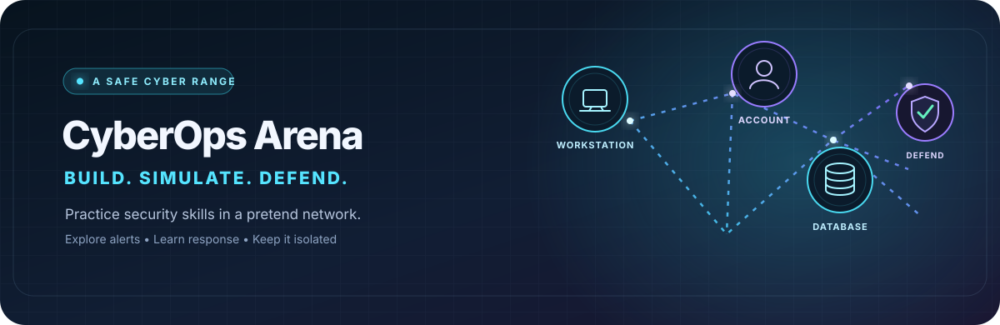

  

<strong>LEARN BY DOING</strong> &nbsp; · &nbsp; <strong>SAFE SIMULATIONS</strong> &nbsp; · &nbsp; <strong>PRACTICE YOUR RESPONSE</strong>

  <a href="#the-workspace"><strong>THE WORKSPACE</strong></a> &nbsp; | &nbsp;
  <a href="#your-first-exercise"><strong>YOUR FIRST EXERCISE</strong></a> &nbsp; | &nbsp;
  <a href="#choose-your-role"><strong>YOUR ROLE</strong></a>

## Welcome to CyberOps Arena

CyberOps Arena is a hands-on learning website for cyber security. Build a pretend network, run a threat exercise, and learn how a security team responds.

<table width="100%">
  <tr>
    <td width="25%" align="center"> <strong>01</strong> Build a network</td>
    <td width="25%" align="center"> <strong>02</strong> Run a scenario</td>
    <td width="25%" align="center"> <strong>03</strong> Review alerts</td>
    <td width="25%" align="center"> <strong>04</strong> Practice a defense</td>
  </tr>
</table>

> **SAFE PRACTICE** — All activity is simulated. The website does not scan real networks, attack real computers, or change real accounts or firewalls.

## The workspace

| | Page | What you can do |
|:---:|---|---|
|  | **Overview** | See your runs, alerts, activity, and saved networks. |
|  | **Network Lab** | Build pretend networks from devices, accounts, and connections. |
|  | **Simulation** | Run a threat scenario one step at a time or let it finish. |
|  | **Incidents** | Review alerts, make detection rules, and practice a response. |
|  | **Access Control** | Admins can create and manage accounts. |

## Your first exercise

1. **Sign in** or choose **Create an account**. Pick Analyst or Defender.
2. **Open Network Lab.** Choose a saved network or create a new one.
3. **Add assets** such as a workstation, user account, or database.
4. **Connect the assets.** Each connection points from one asset to another.
5. **Open Simulation.** Choose a scenario and select **Create isolated run**.
6. **Start the run.** Choose **Run one step** to watch closely, or **Run to completion** to finish it.
7. **Open Incidents.** Review alerts and practice the response allowed by your role.

## Explore each page

###  &nbsp; Overview — your security snapshot

See open alerts, simulation runs, recorded events, and saved network templates. Check alert activity, severity, and recent alerts.

###  &nbsp; Network Lab — build your practice network

Create a named network or choose one that is already saved. Add assets and set each asset’s type, importance, and starting state. Then connect two assets and name the connection.

A connection points from a **source** asset to a **target** asset. For example, a workstation can connect to an employee account. Your network becomes the starting point for a scenario.

###  &nbsp; Simulation — watch a scenario play out

Choose a saved scenario, create an isolated run, and select it from **Your runs**. You can start, step through, pause, or stop the run. Choose **Run to completion** to finish it automatically.

The event stream shows what happened. Run metrics summarize events, successful or blocked steps, assets reached, and modeled risk.

Scenarios can include **account compromise**, **movement between assets**, and **suspicious logins**. Analysts and Admins can create scenarios, choose a network, and add steps by selecting an action, source asset, and target asset. A scenario cannot be changed after a run is created.

Every run has its own copy of the network. A defense in one run does not change the saved network or another run.

###  &nbsp; Incidents — investigate and respond

Review alerts from your runs. **Acknowledge** an alert when you start reviewing it; **Resolve** it when you finish. Refresh the list to see new alerts.

Detection rules look for events such as:

- Repeated failed logins
- Unexpected movement between assets
- Access to an important asset
- An attempt to reach an isolated asset
- A successful account compromise

Analysts and Admins can create detection rules and choose their severity. Defenders and Admins can apply simulated defenses to a run: isolate an asset, disable an account, block a connection, or acknowledge an alert. Add a reason to record why you chose the defense.

###  &nbsp; Access Control — manage accounts

Admins can create accounts, choose roles, and manage existing accounts. People who sign up on their own can choose Analyst or Defender.

## Choose your role

| | Role | Your focus |
|:---:|---|---|
|  | **Analyst** | Build scenarios, investigate alerts, and create detection rules. |
|  | **Defender** | Apply simulated defenses and practice containing a threat. |
|  | **Admin** | Manage accounts and use Analyst and Defender tools. |

## The password cat

On the sign-in and sign-up screens, select the doodle cat beside a password to show or hide it. The cat covers its eyes when the password is hidden and opens its eyes when the password is shown.

## Quick glossary

| Word | What it means here |
|---|---|
| **Template** | A saved plan of a pretend network. |
| **Asset** | A pretend device, service, or account in a network. |
| **Connection** | A one-way path from one asset to another. |
| **Scenario** | A list of pretend actions for an exercise. |
| **Run** | One saved try of a scenario. |
| **Alert** | A warning created when an event matches a rule. |
| **Defense** | A pretend action that limits an attack in a run. |

<strong>BUILD WITH CARE &nbsp; · &nbsp; FOLLOW THE EVIDENCE &nbsp; · &nbsp; DEFEND THE NETWORK</strong>

